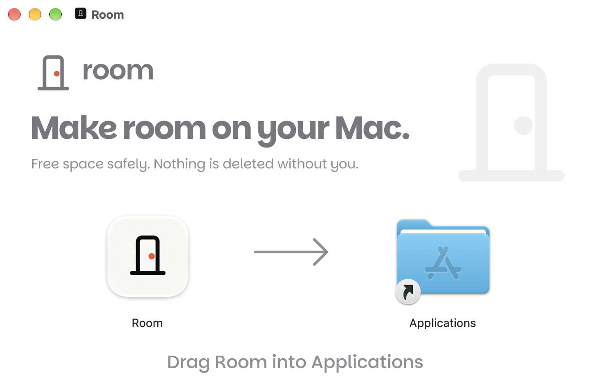
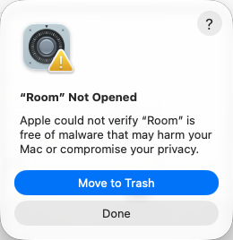
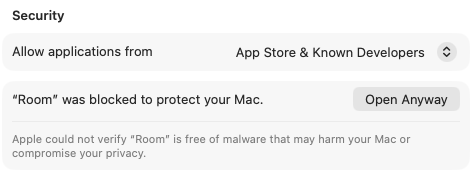
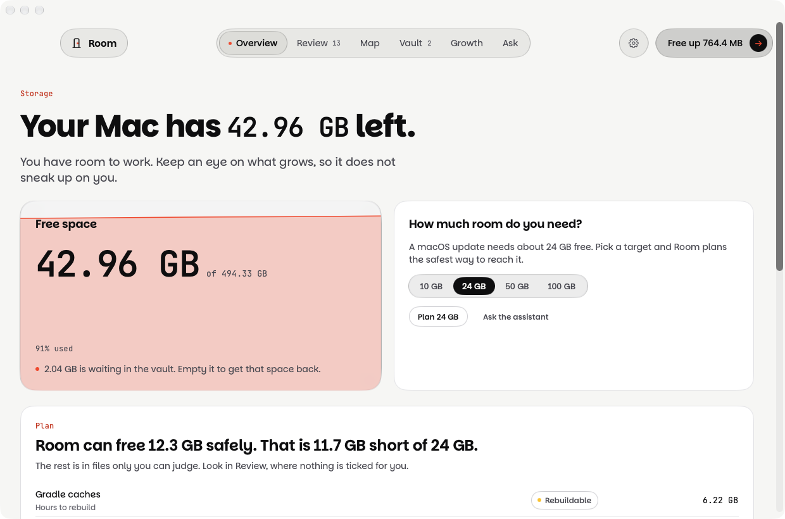
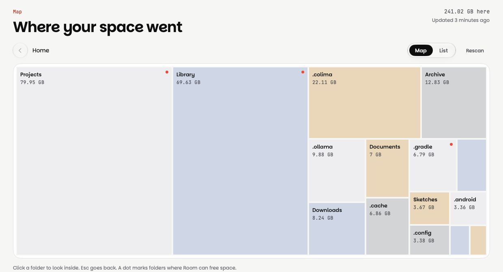
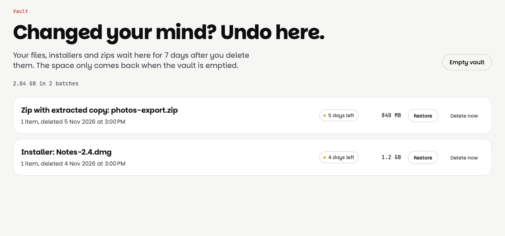

# Room

Room makes space on your Mac, and tells you exactly what it will do first.

It finds what is safe to remove (caches, build output, old simulators, stale `node_modules`, Docker and VM leftovers), shows a size map of the rest, and cleans only after you approve. Your own files (installers, zips, anything you confirm) wait in an undo vault for 7 days. Caches are removed right away because they come back by themselves, and so are rebuildable folders such as `node_modules` unless you turn on "Keep rebuildable folders in the vault too" in Settings.

A product of [EthicCode](https://ethiccode.in/room), built on the [Cinnabar](https://ethiccode.in/cinnabar) design system.

## Requirements

- Apple silicon Mac
- macOS 26 or later

## Install

Room isn't notarized by Apple yet, so your Mac asks you to confirm once. It takes about a minute.

1. Download `Room-1.0.0.dmg` from the [latest release](../../releases/latest), open it, and drag Room into Applications.

   

2. Open Room. macOS says it can't verify it. That's expected. Click **Done** (not Move to Trash).

   

3. Open **System Settings → Privacy & Security**, scroll to **Security**, and click **Open Anyway** next to "Room was blocked". If you don't see it, open Room once more and come back. The button stays for about an hour.

   

4. Confirm with your password or Touch ID, then click **Open**. You won't be asked again. The first time Room looks in Desktop, Documents or Downloads, choose **Allow** so it can measure them.

## Screenshots







## What is in it

- **Review**: ranked, tiered suggestions with the reason for each. Nothing is selected for you in the risky tiers.
- **Map**: a fast treemap of any folder. Click to descend, hover for details.
- **Undo vault**: your own files, installers and zips are moved here for 7 days and can be restored in one click. Caches are deleted directly; rebuildable folders can be vaulted with a setting.
- **Safety rails**: path safety checks, and a git guard that flags repos with uncommitted or unpushed work before anything near them is suggested.
- **Liquid tank**: free space as water that follows your MacBook's tilt, using the built-in motion sensor.
- **Cinnabar Glass**: Cinnabar's flat surfaces and hairlines mixed with macOS 26 Liquid Glass, in light and dark. See [docs/cinnabar-glass.md](docs/cinnabar-glass.md).
- **Privacy**: no accounts, and no upload endpoint is configured in this release. The optional anonymized decision log stays on your Mac and is off until you opt in.

## Build

Needs Xcode 27 (the Command Line Tools alone lack the SwiftUI macro plugin).

```bash
scripts/test.sh            # 118 tests
scripts/bundle.sh release  # dist/Room.app
scripts/package.sh         # dist/Room-<version>.dmg and .zip
```

Developer ID signing and notarization read `DEVELOPER_ID` and `NOTARY_PROFILE` from a `.env` file (see `.env.example`), then run `scripts/notarize.sh`.

## Layout

| Path | What |
| --- | --- |
| `Sources/RoomCore` | Engine: scanner, planner, cleaner, vault, safety rails, settings |
| `Sources/Room` | SwiftUI app and the Cinnabar design system code |
| `Brand` | Room logo, app icon, menu bar icon, DMG and web artwork |
| `Tests/RoomCoreTests` | Swift Testing suites |
| `scripts` | Build, package, notarize, test helpers |

## Status

v1.0.0. Download it from the [latest release](../../releases/latest) or at [ethiccode.in/room](https://ethiccode.in/room).
